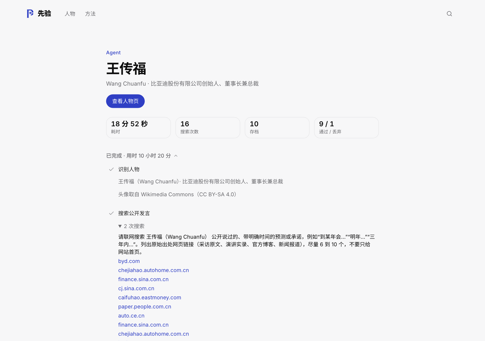
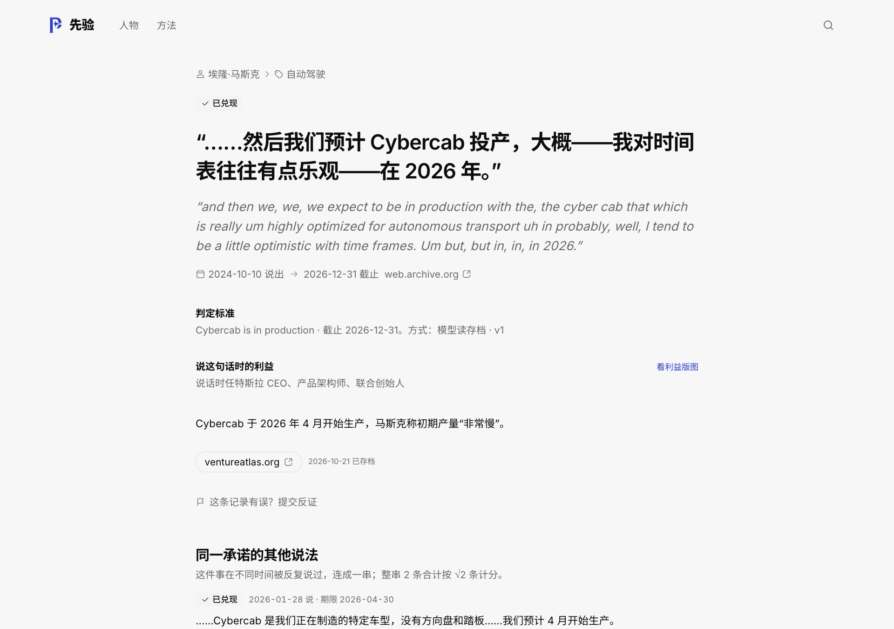
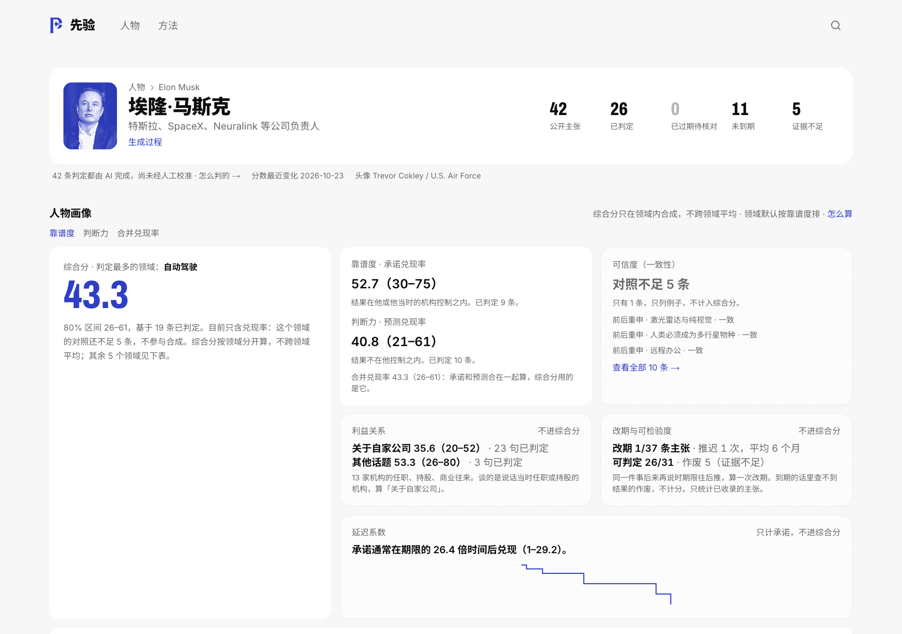
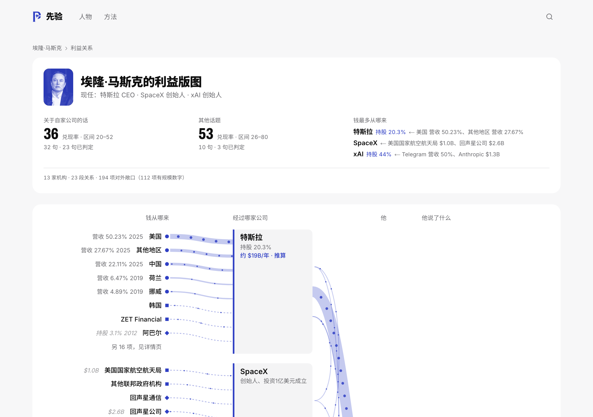
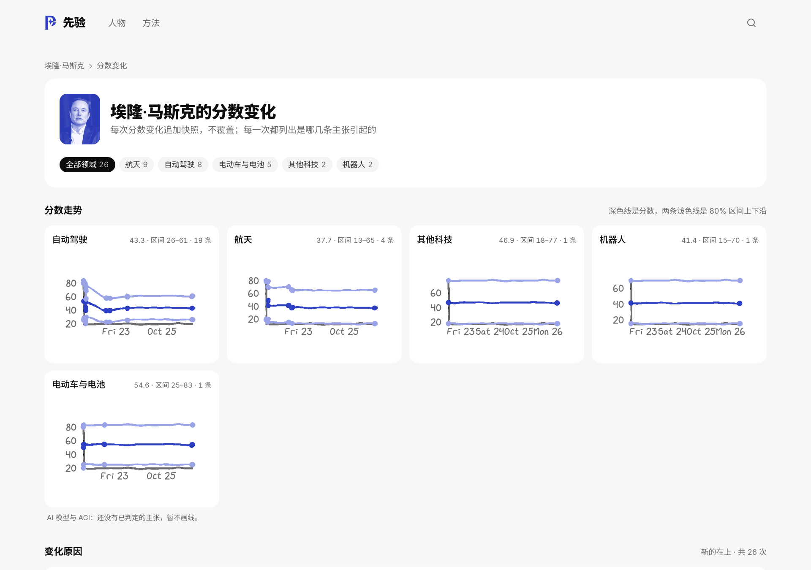

# 先验 · 公众人物说过的话，后来兑现了多少

把公众人物带期限的公开预测和承诺逐句对回原文，到期后对照公开资料核对结果，按领域算出兑现率；他给别人的建议和立场前后是否一致，单独记一项；说话时有没有利益在里面，并排标出。别的 AI 在采信某人的一句新说法之前，可以通过接口或 MCP 先查这个人的记录。

> **Prior** tracks dated public predictions and promises made by public figures. Every claim is matched word-for-word against an archived copy of its source, checked against public evidence when its deadline passes, and scored per domain with an uncertainty interval. Interests (roles, holdings, deals) are shown alongside. AI agents can query a speaker's track record through a REST API or MCP before trusting a new statement. Verdicts are made by AI and have not yet been calibrated against human judgment. The UI and docs are in Chinese.


## 目录

- [现状](#现状2026-10-26)
- [一句话的一生：流水线](#一句话的一生流水线)
- [每个数字都能追到原文](#每个数字都能追到原文)
- [人物画像与计分](#人物画像与计分)
- [给 AI 用：接口和 MCP](#给-ai-用接口和-mcp)
- [质量：评测和已知局限](#质量评测和已知局限)
- [收录范围](#收录范围)
- [技术栈与代码结构](#技术栈与代码结构)
- [本地运行](#本地运行)
- [上线清单](#上线清单)
- [怎么开发这个项目](#怎么开发这个项目)

## 现状（2026-10-26）

- 公开人物 67 位，主张 364 条，其中 69 条已到期判定，23 人在至少一个领域有分数。大部分人物目前还是「样本不足」：多数主张的期限还没到。
- **判定由 AI 完成，尚未经人工校准。** 每条判定带来源层级（人工 / 种子自动核对 / 机器 / 按需分析），网站、`/v1/prior` 和 consult 的返回里都写明这一点。
- **先验对下游 AI 有没有用，还没有被证明。** 上一次对照实验测不出差别，原因见[质量](#质量评测和已知局限)。
- 接下来两周只做「证明价值」三件事，每件都有及格线：
  1. [041](docs/tasks/041-measure-on-demand.md) 线上查一个库里没有的人，能不能在 10 分钟内拿到可信的结果；
  2. [042](docs/tasks/042-blind-check-small.md) 人工盲标 40 条，量 AI 判定和人的一致率；
  3. [043](docs/tasks/043-downstream-retest.md) 给 AI 附上先验，它对「会不会兑现」的判断会不会更准。
- 全部进展见[任务看板](docs/tasks/BOARD.md)，审查发现的问题公开在 [issues](https://github.com/mcbbugu/prediction-tracker/issues)。

## 一句话的一生：流水线

在首页输入一个库里没有的名字，后台会跑完下面这些步骤，每一步的输入、输出和丢弃原因都记下来，在任务页公开（截图是王传福那次的分析过程）。

1. **识别人物**：确认名字指的是谁、是否在收录范围内（见[收录范围](#收录范围)），取授权头像。
2. **多源发现**：按各来源的历史产出率排序，免费来源在前，联网搜索放最后补缺，每人最多 6 次搜索。
   - **播客文字稿**：Lex Fridman、Dwarkesh 自带说话人的文字稿，按节目标题认嘉宾，存档正文只保留嘉宾本人的发言。
   - **SEC 8-K**：本人任职期间、所在公司的新闻稿类申报（EX-99 附件）。
   - **YouTube 字幕**：只取标题里有本人名字的视频；自动字幕标「出自自动字幕」。
   - **RSS**：个人博客和公司新闻室，只收提到本人的文章。
   - **联网搜索**：找访谈、发布会、财报电话会、新闻报道。
3. **存档网页**：程序自己打开网页，存原始字节、提取的正文、两者的哈希、抓取时间和途径；打不开时依次尝试本机浏览器渲染、第三方阅读服务。
4. **抽取预测**：模型只从存档原文里找「此人说的、带明确期限的话」，长文档按「像不像带期限的预测」挑段落。
5. **核对原话**：每条候选必须逐字出现在存档原文里，网页必须写明说话人是此人；分「原话」和「转述」两类。和库里已有主张重复的丢掉。
6. **结构化**：写成可检验的命题（主体、指标、比较方式、阈值、期限）。能用确定数据判定的（例如股价）交给确定性判定器。
7. **分类**：承诺（结果在本人或其机构控制之内）还是预测（不在控制之内）；拿不准的标「类别存疑」，两边都不计分。
8. **到期核对**：期限已过的，联网找结果，证据页同样存档、证据句逐字核对，再由另一段提示词只看存档正文独立判一次。两次不一致标「有分歧」。
9. **利益关系**：任职、持股、商业往来，按说话当时的关系标注每条主张是否涉及自家公司。
10. **可信度对照**：同一话题前后的说法、建议和本人行动是否一致。
11. **计分**：按领域重算，写一份新的分数快照。



同一条流水线也用于每日扩库（`pnpm api:expand`：先入队到期核对，再补可信度，再加少量名单里的新人物，用到当日搜索额度的 80% 停）。

## 每个数字都能追到原文



- **原话必须在存档里**：主张和证据句都要逐字出现在我们自己存的那份原文里，Wayback Machine 快照只作第三方佐证另存链接。页面上每个出处旁边写着存档日期，悬停可以看到抓取途径和正文哈希。
- **模型的话不当证据**：模型只负责找候选链接、提出抽取和判定；网页由程序打开和存档，判定只依据存档原文。
- **可重放**：每次模型调用按内容寻址存下（提示词版本、输入、输出），同样的输入能复现同样的结果。
- **只追加不覆盖**：分数快照只追加；每条主张的每次状态变化都写一条事件；页面据此写出「分数为什么变了」：新判定、撤回、改判。
- **来源层级**：每条判定标明是人工、种子自动核对、机器判定还是按需分析，下游可以自己取舍。
- **可更正**：任何人都可以对一条判定提交反证。提交后自动纳入反证重判，结论变了就改并标「有争议」，没变就保留并公开理由。

## 人物画像与计分



分数**只在领域内**算（AI 模型与 AGI、AI 芯片与算力、自动驾驶、电动车与电池、机器人、航天等 15 个领域），不做跨领域的人品总分。

### 兑现率（打分）

- 承诺和预测分开算：承诺的兑现率叫**靠谱度**，预测的叫**判断力**。
- 已兑现 1、部分兑现 0.5（结果明显少于承诺，但有和目标一致的实质成果）、未兑现 0。
- 按截止日距今加时间权重，半衰期 3 年；κ = 4、中性先验 0.5，把小样本拉向 50。
- 把它看成 Beta 后验，同时给 80% 区间。一个领域有 1 条已判定就出分，旁边总是给区间和条数，例如「56（25–85）· 1 条」；0 条显示「样本不足」。
- **证据不足**：期限已过但查不到能判定结果的可靠资料，作废、不计分，作废条数写在分数旁边。
- **改期合并**：同一承诺在不同时间反复重说、一再改期，连成一串，每条各自判定，整串 k 条合计只算 √k 条的分量。
- 当前公式 v1.3。公式或显示规则一改，版本号加一，旧快照保留。

### 可信度（打分）

- **前后对照**：同一话题立场相反的两句原话；公开说明理由的改变记「一致」，没有说明的翻转记「不一致」。
- **言行对照**：他给别人的建议，对照他自己同期的公开行动（持股披露、公司公告）。
- 同一套 Beta 后验。一个领域少于 5 条对照时只列例子，不出分。

### 综合分

领域内合成：0.7 × 兑现率 + 0.3 × 可信度（两项各自按后验抽样 2000 次相加，取均值和第 10、90 百分位）。某一项没有数据就不参与，旁边写明「目前只含兑现率」。

### 利益关系（不打分，只做旁证）



- 三层数据：人 ↔ 机构（任职、持股、交易，带起止时间和出处）；机构 ↔ 外部敞口（各地区营收、生产场地、供应链、合作、投资，美股机构直接取自 SEC 10-K 的 XBRL）；主张 ↔ 敞口（按说话当天有效的关系判断）。
- 并排给出「关于自家公司的话」和「其他话题」的兑现率。
- 允许把公开披露的数字相乘，估算「归他名下的营收」，结果一律标「推算」，悬停可看算式和每个数的出处；缺一个数就不算。
- 措辞中性：写「说话时任特斯拉 CEO」，不写「有利益冲突」。

### 其他旁证（不打分）

- **改期率**：同一件事后来再说时期限往后推，算一次改期。
- **可检验度**：到期的话里能判定结果的占比。
- **延迟系数**：承诺按 Kaplan–Meier 估计「通常在期限的多少倍时间后兑现」，样本少时向同领域收缩。

### 分数变化



每个领域一条走势线和 80% 区间，下面逐次列出是哪几条主张引起的变化。

## 给 AI 用：接口和 MCP

本地默认地址 `http://127.0.0.1:3011`。

| 接口 | 用途 |
| --- | --- |
| `GET /v1/prior?person=&domain=&as_of=` | 只查库、不调模型的先验：各领域靠谱度、判断力、区间、作废条数、改期与可检验度、延迟系数、可信度对照、说话当天有效的利益关系，以及计入分数的主张（带原文、出处、来源层级）。`as_of` 站在过去某一天看；加 `strict=1` 只用那天之前已经入库的信息（评测用）。 |
| `POST /v1/consult` | 给一句话（`{"query": "…"}`），自动识别人物和领域，返回先验，并找出他以前说过的同一件事。 |
| `POST /mcp` | 无状态 MCP 服务（JSON-RPC over HTTP），工具 `get_prior`，参数同 `/v1/prior`。 |
| `GET /v1/people`、`/v1/people/:id` | 人物列表（分页、排序）、人物概览。 |
| `GET /v1/people/:id/claims`、`/v1/claims` | 某人或全站的主张，筛选、分面计数、游标分页。 |
| `GET /v1/people/:id/claims/:claimId` | 单条主张：原文、命题、判定、证据、存档信息、同一承诺的其他说法。 |
| `GET /v1/people/:id/score-changes`、`/history` | 分数变化原因（分页）、快照序列。 |
| `GET /v1/people/:id/interests`、`/consistency` | 利益版图、可信度对照。 |
| `POST /v1/analyze`、`GET /v1/jobs/:id` | 发起按需分析（每 IP 每天 3 次、全站每天上限可配），查看进度和每一步的记录。 |
| `POST /v1/claims/:claimId/challenges` | 提交反证。 |

```bash
curl "http://127.0.0.1:3011/v1/prior?person=musk&domain=自动驾驶"
curl -X POST http://127.0.0.1:3011/v1/consult -H 'content-type: application/json' \
  -d '{"query":"马斯克说明年实现完全自动驾驶"}'
```

MCP 客户端配置：

```json
{ "mcpServers": { "prior": { "url": "http://127.0.0.1:3011/mcp" } } }
```

## 质量：评测和已知局限

- **评测台**（`pnpm --dir api eval`）：用三份人工整理的种子（马斯克、奥尔特曼、黄仁勋，42 条人写的判定）作对照。2026-10-23 基线：判定一致率 90.5%（Wilson 下界 77.9%，κ 0.848），发现召回 100%。样本小，只覆盖这三个人。
- **交叉判定**：每条到期判定由另一段提示词只看存档正文再判一次，不一致的公开标「有分歧」。
- **下游对照实验**：同一模型回答「这句话会不会兑现」，一组不给先验，一组附上本站先验。严格按说话当天可知的信息回测时，10 道题的先验全是「样本不足」（库里所有判定都写于 2026-10-21 之后），Brier 差 +0.008，95% 区间 [−0.063, 0.041]，**没有差别**。下一步改用模拟时点回测，同时开始前瞻登记（[043](docs/tasks/043-downstream-retest.md)）。
- **按需分析的耗时**：目前一个新人物从提交到完成中位约 20 分钟，主张在约 7 分钟时已经就绪，其余时间花在利益关系和可信度采集上（[041](docs/tasks/041-measure-on-demand.md) 正在量和改）。
- **YouTube 字幕**：本机常被要求登录验证，我们不绕过；运维可以配置自己的 cookies（`YTDLP_COOKIES`）。字幕没有说话人，归属不如播客文字稿可靠。

## 收录范围

- **收**：企业家、投资人、科技与科学人物、经济学家、分析师、媒体评论员、体育与文化界公众人物在公开场合说的两类话：带期限或可判定时间的预测和承诺；对公众的建议和明确立场。另收公开可核查的商业利益关系。
- **不收**：主要身份是政治人物的人（现任或前任政府官员、民选官员和候选人、政党人员、政府发言人），所有国家一视同仁。企业家兼任人大代表、政协委员这类兼职代表席位，或短期担任顾问类职务，照常收录。
- 任何人关于选举结果和政府政策的说法都不收；私人个体和只在私人场合说的话不收；家人、私人关系和政治捐款不进利益关系。

## 技术栈与代码结构

- 网站：Next.js 16、React 19、Tailwind；接口：Bun + Elysia；数据库：Postgres 16。
- 模型和联网搜索：火山方舟（`ARK_*`），所有调用经 `ark_calls` 表限速、记账、按内容寻址缓存；联网搜索按日预算（`AFP_DAILY_BUDGET`）。
- 抓取：直接请求 → 本机 Playwright 渲染 → Jina Reader；SEC 走官方接口；字幕用 yt-dlp。

```
src/                     Next.js 网站和审核台（/review、/review/calibration）
api/src/claims/          发现流水线：识别、多源发现（sources/）、抽取、核对、结构化、分类、到期判定
api/src/evidence/        网页抓取与存档、逐字核对
api/src/scoring/         计分、延迟系数（生存分析）、校准、确定性判定器
api/src/interests/       利益关系、SEC 申报与 XBRL
api/src/consistency/     可信度对照采集
api/src/queries/         对外查询：先验、consult、MCP、列表分页、严格时点
api/src/jobs/            任务队列、worker、限流
api/src/tools/           评测、扩库、清理、按需分析成绩单等脚本
api/sql/init.sql         新数据库的表结构；旧库由 api/src/core/migrate.ts 补齐
data/people/             人工整理的种子主张（真实出处，人写的判定）
data/batches/            建库用的人物名单
data/eval/               评测数据和报告
docs/tasks/              开发任务和看板
public/portraits/        授权人物照片（出处和许可见各人物页）
```

## 本地运行

需要 Docker、Bun 和 Node（pnpm）。

```bash
pnpm install
pnpm api:docker   # Postgres，端口 5434
pnpm api:seed     # 迁移数据库，导入人物和 data/people/*.json 的种子主张
pnpm api:dev      # 接口 http://127.0.0.1:3011
pnpm dev          # 网站 http://localhost:4321
```

密钥写在 `api/.env`：`ARK_API_KEY`、`ARK_BASE_URL`、`ARK_MODEL`；SEC 数据需要 `SEC_USER_AGENT`（名称加联系邮箱）。完整说明见 `api/.env.example` 和 `.env.example`。

后台工作都排进 `jobs` 表，由 worker 执行：

```bash
pnpm api:enqueue -- due        # 已过期、仍待定的主张 → 到期核对
pnpm api:enqueue -- status     # 队列状态和今日搜索额度
pnpm api:worker -- --publish   # 执行队列（本机模式自动公开）；--once 队列空了就退出
pnpm api:expand                # 每日扩库：生成计划、入队、跑到额度的 80% 停
pnpm --dir api eval            # 评测台
pnpm test:web && (cd api && bun test)   # 测试
```

人工入口只有两个：`/review`（反证和模型分歧）和 `/review/calibration`（盲标），口令是 `api/.env` 的 `REVIEW_TOKEN`。更多命令见 [SPEC.md](./SPEC.md)「本地运行」。

## 上线清单

本机能跑不等于能上线。部署前逐项确认：

1. **数据库**：托管的 Postgres 16，`DATABASE_URL` 指向它；接口启动时自动迁移。定期备份（证据存档和判定是只追加的，丢了补不回来）。
2. **接口**（`cd api && bun run start`，常驻）：`NODE_ENV=production` 时本机模式（`AUTO_PUBLISH=1`）会让接口和 worker 拒绝启动；`REVIEW_TOKEN` 至少 24 个字符；`CORS_ORIGINS` 设为网站域名；`SITE_URL` 设为网站地址（consult / MCP 返回的链接用它）。
3. **worker**（`cd api && bun run worker`，常驻）：到期核对和按需分析都靠它。
4. **网站**（`pnpm build && pnpm start`）：`NEXT_PUBLIC_API_URL` 填浏览器能访问到的接口地址，`API_URL` 可填内网地址。
5. **抓取**：服务器上装浏览器（`cd api && node node_modules/playwright/cli.js install chromium`），没装则跳过这一级回退；`JINA_API_KEY`、`IA_ACCESS_KEY` / `IA_SECRET_KEY` 按需填写。
6. **每日扩库**（可选）：`deploy/com.prediction-tracker.expand.plist` 是 macOS 定时任务模板，把 `/path/to/prediction-tracker` 换成你的目录后用 `launchctl load` 启用。

## 怎么开发这个项目

- **[SPEC.md](./SPEC.md)** 是产品方向、原则和计分口径的唯一来源，开发前先读；和它冲突的改动先改 SPEC。
- **[docs/tasks/](docs/tasks/BOARD.md)** 每个任务一份说明：目标、做法、范围、验收标准，做完写完成记录和提交号。
- **审查 issue**：外部审查和自动审查发现的问题开成 issue，核对属实后转成任务，修完在 issue 下回复。
- 大部分代码由 AI 编程助手（Claude Code、Cursor）按任务说明写成，由维护者检查后提交。

## 许可

MIT
